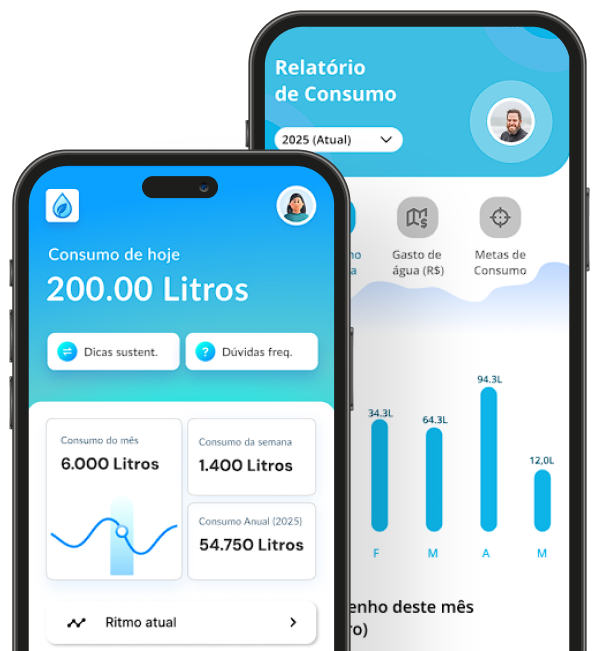
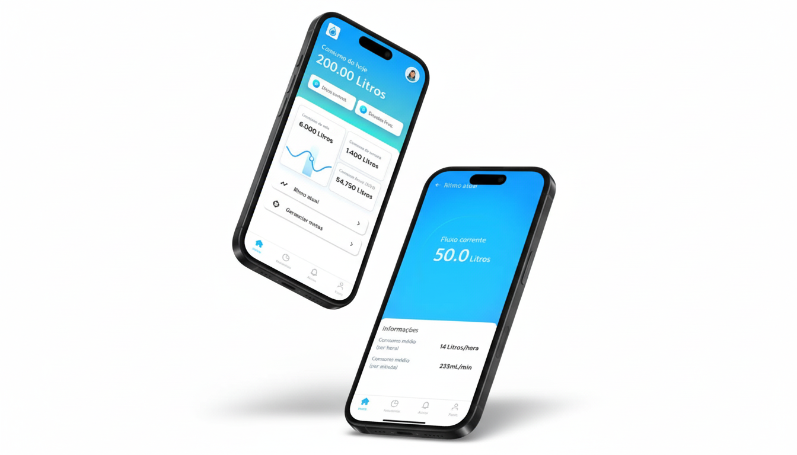

<div align="center">


# LetControl

### Monitoramento inteligente de consumo de água

*"Preserve hoje. Garanta o amanhã."*

[](https://letcontrol.vercel.app)


</div>

---

## 💧 Sobre o projeto

O **LetControl** é um sistema de monitoramento de consumo de água residencial em tempo real, desenvolvido como Trabalho de Conclusão de Curso na **Etec de Cotia**.

No Brasil, cerca de **40% da água tratada é desperdiçada**, e grande parte das famílias não tem nenhuma visibilidade sobre quanto consomem até a conta chegar. O LetControl ataca esse problema com um sensor de vazão acoplado à tubulação (ESP32 + sensor YF-G1) que envia leituras em tempo real para uma plataforma web, onde o usuário acompanha consumo, define metas, recebe alertas de vazamento e analisa relatórios — tudo por uma fração do custo das soluções voltadas pra indústria.

<p align="center">
  
  
</p>

🔗 **Site publicado:** [letcontrol.vercel.app](https://letcontrol.vercel.app)

---

## ✨ Funcionalidades

- 📊 **Consumo em tempo real** — vazão atual, volume do dia e histórico por hora, direto do sensor
- 🎯 **Metas personalizadas** — diária, semanal e mensal, com congelamento histórico (mudar a meta hoje não reescreve relatórios passados)
- 🚨 **Alertas inteligentes** — detecção automática de vazamento (fluxo contínuo anormal) e consumo fora do padrão
- 📈 **Relatórios e Eco Score** — por semana, mês, ano ou período personalizado, com exportação em PDF e CSV
- 🔌 **Múltiplos dispositivos** — cadastre mais de um sensor e alterne entre eles, ou veja o consumo da casa toda somado
- 🌓 **Tema claro/escuro**, instalável como **PWA** (funciona offline e pode ser adicionado à tela inicial)
- 🔒 **Autenticação e regras de segurança** por usuário no Firebase, com cada conta só acessando os próprios dados

---

## 🛠️ Tecnologias

| Camada | Tecnologias |
|---|---|
| **Hardware** | ESP32, sensor de vazão YF-G1, Arduino IDE |
| **Frontend** | HTML, CSS e JavaScript puros (sem framework), Chart.js, jsPDF |
| **Backend / Dados** | Firebase Realtime Database, Firebase Authentication, Cloud Functions |
| **Hospedagem** | Vercel (web), Firebase (banco e funções) |
| **PWA** | Service Worker com estratégia network-first, Web App Manifest |

### Como os dados fluem

```
Sensor (ESP32)  →  Firebase Realtime Database  →  Regras de segurança validam
                                                          ↓
                                        Painel web (tempo real, por usuário)
```

---

## 📁 Estrutura do projeto

```
letcontrol-site/
├── letcontrol/
│   ├── index.html          # Landing page
│   ├── pages/
│   │   ├── login.html       # Autenticação
│   │   └── dashboard.html   # Painel do usuário (app)
│   ├── js/                  # Lógica do front-end (dashboard, auth, PWA...)
│   ├── css/                 # Estilos
│   └── sw.js                # Service Worker (PWA)
├── functions/                # Cloud Functions (detecção de anomalia, push)
├── database.rules.json       # Regras de segurança do Realtime Database
├── firebase.json             # Configuração do Firebase (hosting/functions/db)
└── vercel.json                # Roteamento do deploy na Vercel
```

---

## 🚀 Rodando localmente

1. Clone o repositório:
   ```bash
   git clone https://github.com/danielmoraes08/LetControl.git
   cd LetControl/letcontrol-site
   ```
2. Configure o seu próprio projeto Firebase em `letcontrol/js/firebase-config.js` (Realtime Database + Authentication habilitados).
3. Publique as regras de segurança:
   ```bash
   firebase deploy --only database --project SEU_PROJETO
   ```
4. Sirva a pasta `letcontrol/` com qualquer servidor estático (ex.: extensão *Live Server* do VS Code) e acesse `pages/login.html`.

> O Service Worker (PWA) não registra em `localhost`/`127.0.0.1` de propósito, pra testes locais sempre pegarem a versão mais recente do código.

---

## 👥 Equipe

Projeto desenvolvido por alunos da **Etec de Cotia** como Trabalho de Conclusão de Curso (2026), orientados por **Debaldo Valverde** e **Julia Ingrid**.

| | |
|---|---|
| Daniel Moraes | Site, segurança e integração web/mobile |
| Gustavo Henrique | Introdução e metodologia |
| Murilo Morales | Documentação técnica |
| Rafael Queiroz | Hardware |
| Ryan Monteiro | Hardware |
| Vitor Jacomini | Contextualização social |
| Vitor Reis | Banco de dados e aplicativo |
| Yasmin Bernardi | Público-alvo e pesquisa |

---

<div align="center">

📧 letcontrol.contact@gmail.com · 💧 *"Cada gota conta. Monitore o presente, garanta o futuro."*

</div>
